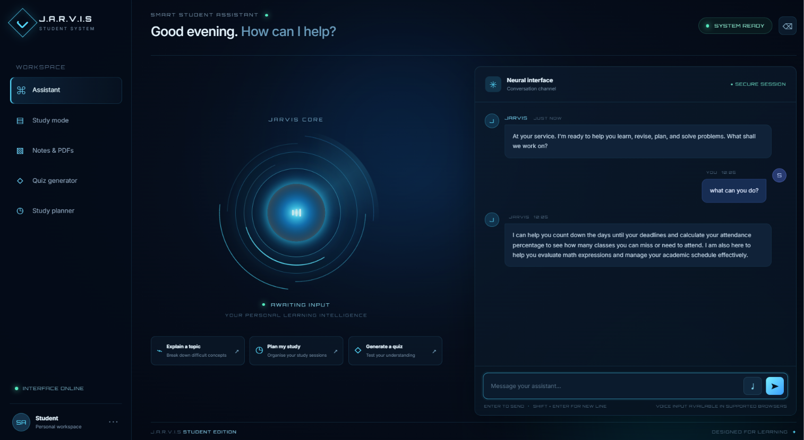
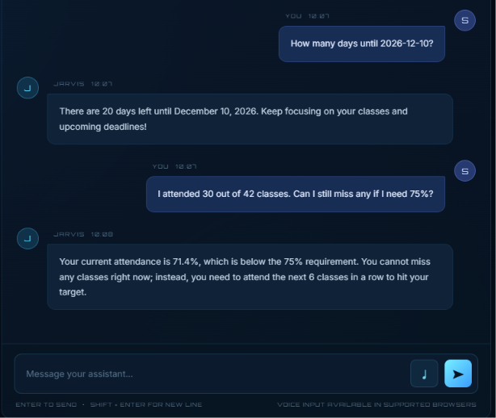
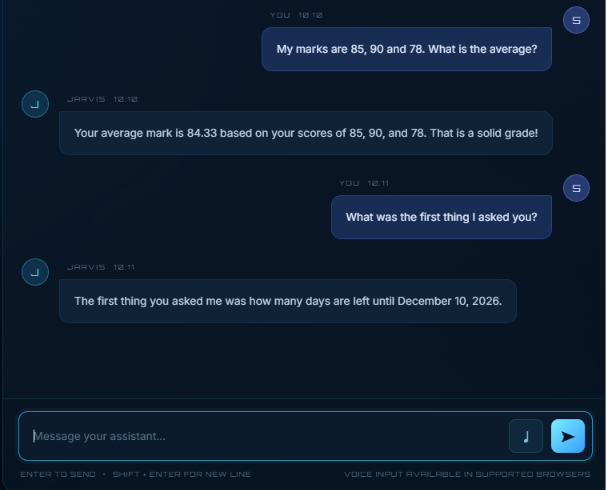

# 🎓 Smart Student Assistant

An AI agent that helps college students plan their academics. Built with Python, LangGraph and Google Gemini.

## What it does
- 📅 **Exam countdown**: counts days until a date
- ✅ **Attendance checker**: tells how many classes you can still miss (or must attend) to reach 75%
- 🧮 **Calculator**: averages, percentages and marks
- 🧠 **Memory**: remembers earlier questions in the chat

## How it works
The AI model reads your question, decides which tool to call, reads the result, and repeats until it can write a final answer. LangGraph runs this as a loop between a model node and a tools node.

## Tech used
Python, LangGraph, LangChain, Google Gemini API, Antigravity IDE

## How to run
1. Install Python 3.13 or 3.14
2. Create and activate a virtual environment:
   ```
   py -3.14 -m venv .venv
   .venv\Scripts\activate
   ```
3. Install packages:
   ```
   pip install -r requirements.txt
   ```
4. Get a free API key from https://aistudio.google.com/apikey
5. Create a file named `.env` containing:
   ```
   GOOGLE_API_KEY=your-key-here
   MODEL=google_genai:gemini-3.5-flash-lite
   ```
6. Run:
   ```
   python agent.py
   ```

## Example questions
- How many days until 2026-12-10?
- I attended 30 out of 42 classes. Can I still miss any if I need 75%?
- My marks are 85, 90 and 78. What is the average?

## Web interface (JARVIS)

1. Open a terminal in the `backend` folder:
   ```
   py -3.14 -m venv .venv
   .venv\Scripts\activate
   pip install -r requirements.txt
   ```
2. Copy `.env.example` to `.env` and add your free Gemini key from https://aistudio.google.com/apikey
3. Start the backend:
   ```
   python server.py
   ```
4. In a second terminal, open the `frontend` folder and run:
   ```
   python -m http.server 5500
   ```
5. Open http://localhost:5500

## Project structure
- `backend/assistant.py`: the LangGraph agent with its three tools
- `backend/server.py`: Flask API that connects the agent to the web page
- `frontend/`: the JARVIS-style chat interface (HTML, CSS, JavaScript)
- `agent.py`: the original terminal version
  
## Note
Built by following a LangGraph tutorial manual and customised with my own student tools.

## Screenshots




